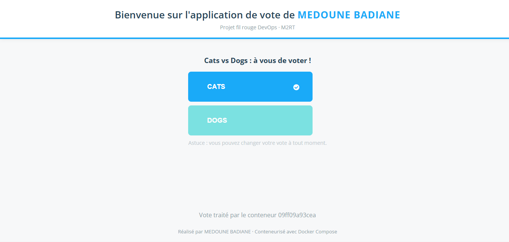
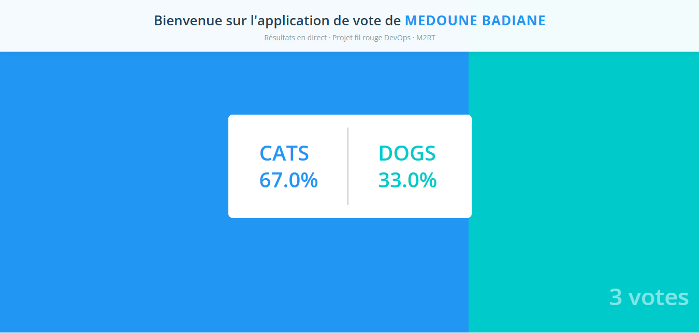

# Application de vote de MEDOUNE BADIANE

Projet fil rouge DevOps · M2RT · conteneurisation avec Docker Compose

Application web de vote **Cats vs Dogs** : on vote sur une page, et les résultats s'affichent en direct sur une autre.
Toute l'application tourne dans des conteneurs Docker : il n'y a rien d'autre à installer que Docker.

Base de départ : [dockersamples/example-voting-app](https://github.com/dockersamples/example-voting-app) (licence Apache 2.0),
adaptée pour ce projet (configuration par variables d'environnement, images de production, utilisateurs non-root, interface personnalisée).

---

## Architecture

| Rôle dans le TP | Service | Technologie | Accès |
|---|---|---|---|
| Frontend | `vote` : page de vote | Python 3.11 / Flask, servi par gunicorn | http://localhost:8080 |
| Frontend | `result` : page des résultats en direct | Node.js 18 / Express / Socket.io | http://localhost:8081 |
| Backend | `worker` : traitement des votes | C# / .NET 8 | Aucun port (réseau interne) |
| Base de données | `db` : stockage durable des votes | PostgreSQL 15 | Réseau interne uniquement |
| File d'attente | `redis` : réception rapide des votes | Redis | Réseau interne uniquement |

Parcours d'un vote :

```
Navigateur ──> vote (8080) ──rpush──> Redis ──> worker ──INSERT/UPDATE──> PostgreSQL ──COUNT──> result (8081) ──> Navigateur
```

1. L'utilisateur vote sur la page `vote`. Un cookie `voter_id` garantit une personne = un vote.
2. `vote` dépose le vote dans la file Redis.
3. `worker` retire le vote de Redis et l'enregistre dans PostgreSQL (il remplace l'ancien vote si la personne change d'avis).
4. `result` compte les votes chaque seconde et les envoie en temps réel au navigateur.

---

## Prérequis

- **Docker Desktop** (Windows, macOS) ou **Docker Engine avec le plugin Compose** (Linux).
  Vérification : `docker --version` puis `docker compose version`.
- **Git**, pour cloner le dépôt.
- Les ports **8080** et **8081** libres sur la machine (modifiables dans `.env`).

Sous Windows, Docker Desktop doit utiliser **WSL 2**, et l'hyperviseur Windows doit être actif
(`Get-ComputerInfo -Property "HyperVisorPresent"` doit afficher `True`).

---

## Lancement

```bash
# 1. Cloner le dépôt
git clone https://github.com/medounebadiane/projet_fil_rouge_devops.git
cd projet_fil_rouge_devops

# 2. Créer le fichier de configuration à partir du modèle
cp .env.example .env            # Windows PowerShell : copy .env.example .env

# 3. Ouvrir .env et remplacer changez_moi par votre propre mot de passe (POSTGRES_PASSWORD)

# 4. Construire les images et lancer les 5 services
docker compose up --build
```

Le premier lancement prend plusieurs minutes (téléchargement des images de base et compilation).
L'application est prête quand les journaux se stabilisent.

Pour lancer en arrière-plan et récupérer la main sur le terminal : `docker compose up --build -d`.

---

## Accès

| Page | Adresse |
|---|---|
| Page de vote | http://localhost:8080 |
| Page des résultats | http://localhost:8081 (ou bouton **« Voir les résultats »** sur la page de vote) |

---

## Procédure de vérification

1. Ouvrir http://localhost:8080 : le bandeau **« Bienvenue sur l'application de vote de MEDOUNE BADIANE »** s'affiche.
2. Cliquer sur **Cats** ou **Dogs** : le bouton choisi est coché ✔ et l'autre est grisé.
3. Cliquer sur **« Voir les résultats »** : la page des résultats s'ouvre dans un nouvel onglet et affiche **1 vote**.
4. Revenir sur la page de vote et changer de choix : le résultat change, mais le total reste à **1 vote** (une personne = un vote).
5. Vérifier l'état des conteneurs :

```bash
docker compose ps
```

Les 5 services doivent être `Up`, et `vote`, `redis` et `db` doivent être `(healthy)`.

6. Voir le traitement d'un vote par le backend :

```bash
docker compose logs worker
```

Une ligne `Processing vote for 'a' by '…'` apparaît pour chaque vote.

Pour voter avec plusieurs personnes depuis la même machine, utiliser des profils de navigateur différents
(chaque profil a son propre cookie, donc compte comme un votant différent).

Test de charge facultatif : `docker compose --profile seed up -d` envoie 3000 votes de test.

---

## Arrêt

```bash
docker compose down        # arrête et supprime les conteneurs ; les votes sont conservés (volume db-data)
docker compose down -v     # supprime aussi le volume : la base repart de zéro
```

Si l'application a été lancée au premier plan, faire d'abord `Ctrl + C`.

---

## Configuration

Tous les réglages sont dans le fichier `.env`, créé à partir de `.env.example`.
**Le fichier `.env` contient le mot de passe de la base : il est exclu de Git par le `.gitignore` et ne doit jamais être publié.**

| Variable | Valeur par défaut | Rôle |
|---|---|---|
| `POSTGRES_PASSWORD` | aucune, **obligatoire** | Mot de passe de PostgreSQL. Sans lui, Docker Compose refuse de démarrer |
| `POSTGRES_USER` | `postgres` | Utilisateur PostgreSQL |
| `POSTGRES_DB` | `postgres` | Nom de la base |
| `APP_AUTEUR` | `MEDOUNE BADIANE` | Nom affiché dans le bandeau des deux pages |
| `OPTION_A` / `OPTION_B` | `Cats` / `Dogs` | Les deux choix du vote |
| `VOTE_PORT` | `8080` | Port de la page de vote sur la machine |
| `RESULT_PORT` | `8081` | Port de la page des résultats sur la machine |
| `RESULT_URL` | `http://localhost:8081` | Adresse ouverte par le bouton « Voir les résultats » |

Après une modification de `.env`, relancer avec `docker compose up --build`.
Si `POSTGRES_PASSWORD` est modifié alors que la base existe déjà, faire `docker compose down -v` avant de relancer :
PostgreSQL ne lit le mot de passe qu'à la création de la base.

---

## Choix de configuration

- **Correspondance avec le TP** : `vote` et `result` forment le frontend (les deux pages ouvertes dans le navigateur),
  `worker` est le backend (traitement sans interface), PostgreSQL est la base de données et Redis sert de file d'attente.
- **Aucun secret dans le dépôt** : les mots de passe et adresses sont lus dans des variables d'environnement par les trois
  services (`vote/app.py`, `worker/Program.cs`, `result/server.js`) et transmis par `compose.yaml` depuis le fichier `.env`.
- **Deux réseaux** : `front-tier` pour les pages accessibles, `back-tier` pour les échanges internes.
  Redis et PostgreSQL ne sont que sur `back-tier` et n'exposent aucun port : ils sont inaccessibles depuis l'extérieur.
- **Persistance** : le volume nommé `db-data` conserve les votes quand les conteneurs sont arrêtés ou recréés.
- **Ordre de démarrage** : des healthchecks vérifient que Redis et PostgreSQL répondent ; `vote`, `worker` et `result`
  n'attendent pas seulement leur démarrage mais leur bon fonctionnement (`condition: service_healthy`).
- **Images de production** : `vote` utilise l'étape `final` de son Dockerfile (gunicorn), `result` lance `node server.js`,
  et aucun dossier de la machine n'est monté dans les conteneurs applicatifs : l'application tourne entièrement depuis ses images.
- **Sécurité des images** : Dockerfiles multi-étapes (le compilateur .NET n'est pas dans l'image finale du worker),
  exécution avec un utilisateur non-root pour `vote` et `worker`, et un `.dockerignore` par service pour exclure
  fichiers locaux et secrets du contexte de construction.

---

## Test effectué

Test réalisé le 26 novembre 2026 sous Windows 11 avec Docker Desktop (WSL 2), après `docker compose down -v` puis `docker compose up --build` :

- les 5 conteneurs ont démarré, le worker en .NET 8 compris ;
- trois votes ont été émis depuis trois profils de navigateur différents (2 pour Cats, 1 pour Dogs) ;
- la page des résultats affiche **Cats 67 % / Dogs 33 % · 3 votes**, ce qui confirme tout le parcours
  vote → Redis → worker → PostgreSQL → result avec la configuration lue dans `.env`.

| Page de vote | Page des résultats |
|---|---|
|  |  |

---

## Dépannage

| Problème | Solution |
|---|---|
| `failed to connect to the docker API` | Docker Desktop n'est pas lancé : l'ouvrir et attendre « Engine running » |
| `required variable POSTGRES_PASSWORD is missing` | Le fichier `.env` manque ou ne définit pas le mot de passe : refaire l'étape 2 et 3 du lancement |
| `password authentication failed` dans les journaux | Le mot de passe a changé après la création de la base : `docker compose down -v` puis relancer |
| `port is already allocated` | Le port 8080 ou 8081 est pris : changer `VOTE_PORT` / `RESULT_PORT` (et `RESULT_URL`) dans `.env` |
| Windows : « Windows hypervisor is not running » | Dans PowerShell administrateur : `wsl --install --no-distribution` puis `bcdedit /set hypervisorlaunchtype auto`, et redémarrer |

---

## Structure du dépôt

```
├── vote/                 Frontend : page de vote (Python / Flask) + Dockerfile + .dockerignore
├── result/               Frontend : page des résultats (Node.js) + Dockerfile + .dockerignore
├── worker/               Backend : traitement des votes (C# / .NET 8) + Dockerfile + .dockerignore
├── healthchecks/         Scripts de vérification de Redis et PostgreSQL
├── seed-data/            Générateur de votes pour les tests de charge
├── k8s-specifications/   Déploiement Kubernetes (module à venir)
├── docs/captures/        Captures du test
├── compose.yaml          Orchestration des 5 services
├── .env.example          Modèle de configuration (sans secret)
└── .gitignore            Exclut notamment .env
```

---

Réalisé par **MEDOUNE BADIANE** · Projet fil rouge DevOps · M2RT
